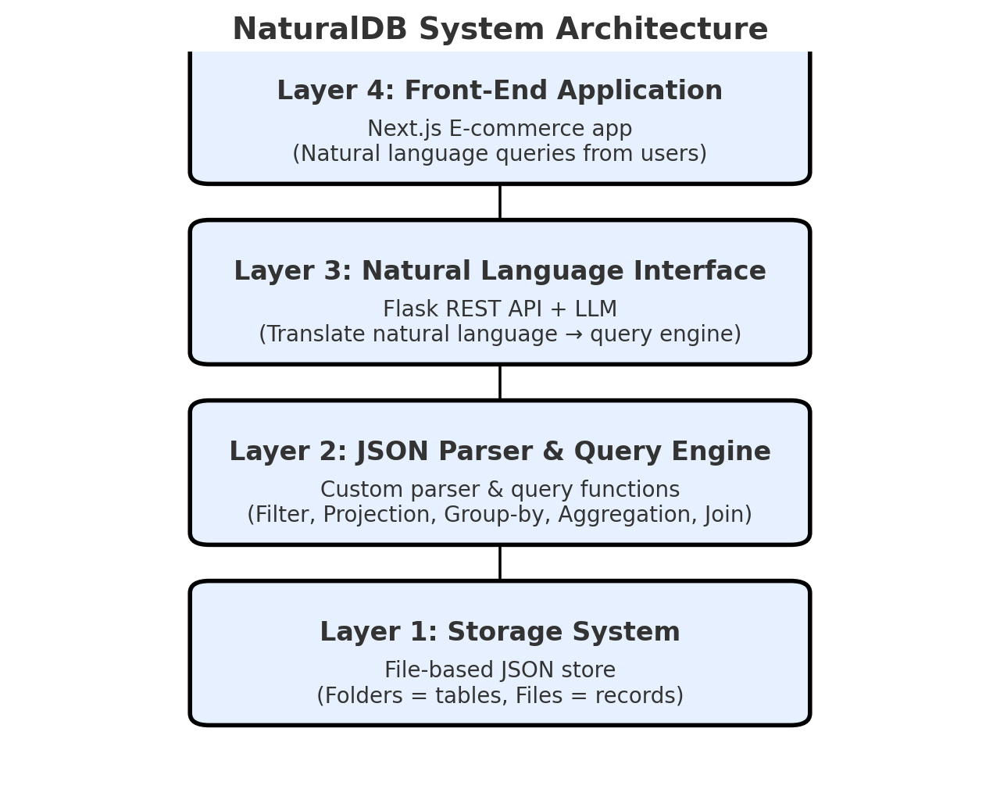

# NaturalDB 🚀  
*A Natural-Language-Driven NoSQL Database System with E-commerce Demo*  



## Overview  
**NaturalDB** is a fully-functional **NoSQL database system** built from scratch in Python, designed to store and query JSON data with both structured queries and **natural language interaction** powered by OpenAI.

### Key Features  
- ✅ **Complete CRUD operations** (Create, Read, Update, Delete)
- ✅ **Advanced query engine**: filtering, projection, sorting, aggregation, joins
- ✅ **9 filter operators**: `eq`, `ne`, `gt`, `gte`, `lt`, `lte`, `in`, `nin`, `contains`
- ✅ **File-based JSON storage** with thread-safe operations
- ✅ **OpenAI-powered natural language queries** using Function Calling
- ✅ **RESTful Flask API** with comprehensive endpoints
- ✅ **Modern React frontend** with TypeScript and Ant Design
- ✅ **Real-time statistics** and interactive filtering
- ✅ **Production-ready** with error handling and validation

### Demo Dataset
This project uses the [Amazon Sales Dataset](https://www.kaggle.com/datasets/karkavelrajaj/amazon-sales-dataset) containing:
- **1,351 products** across 18 categories
- **9,269 customer reviews** with ratings and content
- Real product data: prices, discounts, ratings, images

The included **React e-commerce application** demonstrates browsing products, viewing details, reading reviews, and filtering by multiple criteria.  

---

## Architecture 🏗️  

NaturalDB is built in **four layers**, each providing increasing levels of abstraction:

### Layer 1: Storage System  
**File-based NoSQL storage with thread-safe operations**
- Each database is a directory under `data/{user_id}/{database_name}/`
- Each table is a subdirectory with JSON files for records
- Records stored as `{record_id}.json` with automatic serialization
- Metadata tracking for table schemas and indexes
- File-locking mechanism for concurrent access safety
- Environment-configurable data paths for testing

**Key Components:**
- `storage.py` - Main storage interface with CRUD operations
- `file_system.py` - Thread-safe file operations with locking
- Supports user isolation and multi-database architecture

### Layer 2: Query Engine  
**Powerful query processing with MongoDB-like syntax**
- Comprehensive filter operators: `eq`, `ne`, `gt`, `gte`, `lt`, `lte`, `in`, `nin`, `contains`
- Projection for selecting specific fields
- Multi-field sorting (ascending/descending)
- Aggregation operations: `count`, `sum`, `avg`, `min`, `max`, `group_by`
- Join operations across tables
- Chainable query builder pattern (similar to MongoDB)
- Pagination support with `limit` and `skip`

**Key Components:**
- `query_engine.py` - Main query interface and orchestration
- `operations.py` - Filter, sort, aggregate, and join implementations
- Optimized for performance with lazy evaluation

**Example Usage:**
```python
# Chainable query builder
engine.table('products')
    .filter_by('price', 100, 'gt')
    .filter_by('rating', 4.5, 'gte')
    .sort('price', 'asc')
    .limit(10)
    .all()

# Direct queries
engine.find('products', filters=[
    {'field': 'category', 'operator': 'in', 'value': ['Electronics', 'Books']}
])
```

### Layer 3: Natural Language Interface  
**OpenAI-powered natural language to database operations**

Converts natural language queries into structured database operations using OpenAI's Function Calling API.

**Architecture:**
- `tool_registry.py` - Automatically registers QueryEngine methods as OpenAI tools with type information
- `nl_query_processor.py` - Processes natural language using GPT-4o-mini, converts to function calls
- `executor.py` - Executes function calls on QueryEngine with result serialization
- `naturaldb.py` - Unified high-level API for both simple and interactive queries
- `function_calling.py` - Core infrastructure for automatic tool registration from Python methods

**Features:**
- Automatic tool schema generation from Python type hints
- Support for single-turn and multi-turn conversations
- Confirmation callbacks for sensitive operations (update, delete)
- Comprehensive system prompts with operator documentation
- Graceful fallback when API key not available

**Example Usage:**
```python
from naturaldb.nlp_interface import NaturalDB
from naturaldb.entities import User, Database

db = NaturalDB(User("demo_user", "Demo"), Database("amazon"))

# Simple query
result = db.query("Show me products with rating above 4.5 and price under $100")

# Interactive mode (multi-turn with automatic execution)
result = db.query_interactive("Find the top 5 most expensive electronics")
```

**Supported Natural Language Operations:**
- Queries: "find all products with price > 100"
- Filtering: "show products with rating >= 4.5"
- Multi-condition: "products in USB Cables or Wall Chargers with discount > 50%"
- Sorting: "sort by price descending"
- Aggregation: "count how many products have 5-star ratings"
- Table operations: "create a table called favorites"
- Data manipulation: "insert a product with name='Laptop', price=999"

### Layer 4: Frontend Application  
**Modern React e-commerce demo with real-time filtering**

A production-quality single-page application showcasing NaturalDB capabilities.

**Technology Stack:**
- **React 19.1** with **TypeScript 5.8**
- **Ant Design 5.x** for UI components
- **Vite 6.3** for blazing-fast builds
- **React Router 7.1** for navigation
- **Axios** for API communication
- **LESS** for styling

**Implemented Pages:**

1. **HomePage** (`/`)
   - Real-time database statistics (total products, highly rated, big discounts)
   - Featured products showcase
   - Quick navigation with filter presets
   - Clickable stats that apply filters automatically

2. **ProductsPage** (`/products`)
   - Grid layout with 24 products per page
   - **Advanced filtering:**
     - Search by product name
     - Multi-select categories (using `in` operator)
     - Price range slider ($0 - $100,000)
     - Minimum rating filter
     - Minimum discount filter
   - **Sorting options:**
     - Rating (high to low / low to high)
     - Price (low to high / high to low)
     - Discount (high to low)
   - Pagination with total count
   - Filter state persistence in localStorage
   - URL parameter support for preset filters

3. **ProductDetailPage** (`/products/:productId`)
   - High-resolution product images
   - Full product information and specifications
   - Price comparison (original vs discounted)
   - Savings calculator
   - Rating and review count
   - Detailed product description
   - **Customer Reviews Section:**
     - All reviews with user names
     - Review titles and content
     - Pagination for reviews
     - Review count badge
   - Link to Amazon product page
   - Responsive design for mobile

4. **QueryBuilderPage** (`/query-builder`) - *Coming Soon*
   - Visual query builder interface
   - Drag-and-drop filter construction

5. **DashboardPage** (`/dashboard`) - *Coming Soon*
   - Analytics charts and visualizations
   - Sales trends and statistics

**Features:**
- ✅ Fully responsive (mobile, tablet, desktop)
- ✅ Real-time search and filtering
- ✅ Smooth animations and transitions
- ✅ Error handling with user-friendly messages
- ✅ Loading states for all async operations
- ✅ SEO-friendly routing
- ✅ Accessible UI components  

---

## Quick Start 💻  

### Prerequisites  
- **Python 3.10+**
- **Node.js 18+** and npm
- **OpenAI API Key** (for natural language features)

### Installation  

**1. Clone the repository**
```bash
git clone https://github.com/felix-wang-0307/NaturalDB.git
cd NaturalDB
```

**2. Backend Setup**
```bash
# Create virtual environment (recommended)
python -m venv venv
source venv/bin/activate  # On Windows: venv\Scripts\activate

# Install dependencies
pip install -r requirements.txt

# Configure environment variables
# Copy the .env file and add your OpenAI API key
cp naturaldb/.env.example naturaldb/.env
# Edit naturaldb/.env and add: OPENAI_API_KEY=your-key-here
```

**3. Frontend Setup**
```bash
cd frontend
npm install
```

**4. Start the Application**

Open two terminal windows:

**Terminal 1 - Backend:**
```bash
# From project root
python run_api.py --port 8080
```

**Terminal 2 - Frontend:**
```bash
# From frontend directory
cd frontend
npm run dev
```

**5. Access the Application**
- **Frontend**: http://localhost:5173
- **Backend API**: http://localhost:8080
- **API Documentation**: http://localhost:8080/

---

## API Documentation 📚

### RESTful Endpoints

#### Health & Info
- `GET /health` - Health check
- `GET /` - API information and endpoint list

#### Database Operations
- `GET /api/databases` - List all databases
- `POST /api/databases` - Create new database
- `DELETE /api/databases/{user_id}/{db_name}` - Delete database

#### Table Operations
- `GET /api/databases/{user_id}/{db_name}/tables` - List all tables
- `POST /api/databases/{user_id}/{db_name}/tables` - Create table
- `DELETE /api/databases/{user_id}/{db_name}/tables/{table_name}` - Delete table

#### Record Operations
- `GET /api/databases/{user_id}/{db_name}/tables/{table_name}/records` - Get all records
- `GET /api/databases/{user_id}/{db_name}/tables/{table_name}/records/{record_id}` - Get single record
- `POST /api/databases/{user_id}/{db_name}/tables/{table_name}/records` - Create record
- `PUT /api/databases/{user_id}/{db_name}/tables/{table_name}/records/{record_id}` - Update record
- `DELETE /api/databases/{user_id}/{db_name}/tables/{table_name}/records/{record_id}` - Delete record

#### Query Operations
- `POST /api/databases/{user_id}/{db_name}/query/` - Execute structured query
- `POST /api/databases/{user_id}/{db_name}/query/count` - Count records
- `POST /api/databases/{user_id}/{db_name}/query/aggregate` - Aggregation queries

#### Natural Language Query (NLP)
- `POST /api/databases/{user_id}/{db_name}/nl-query` - Execute natural language query
- `GET /api/databases/{user_id}/{db_name}/nl-query/status` - Check NLP availability
- `GET /api/databases/{user_id}/{db_name}/nl-query/examples` - Get example queries

### Query API Examples

**Simple Filter Query:**
```bash
curl -X POST http://localhost:8080/api/databases/demo_user/amazon/query/ \
  -H "Content-Type: application/json" \
  -d '{
    "table": "Products",
    "filters": [
      {"field": "rating", "operator": "gte", "value": 4.5},
      {"field": "price", "operator": "lt", "value": 100}
    ],
    "sort": [{"field": "rating", "direction": "desc"}],
    "limit": 10
  }'
```

**Multi-Category Filter (using `in` operator):**
```bash
curl -X POST http://localhost:8080/api/databases/demo_user/amazon/query/ \
  -H "Content-Type: application/json" \
  -d '{
    "table": "Products",
    "filters": [
      {"field": "category", "operator": "in", "value": ["USBCables", "WallChargers"]}
    ]
  }'
```

**Count Query:**
```bash
curl -X POST http://localhost:8080/api/databases/demo_user/amazon/query/count \
  -H "Content-Type: application/json" \
  -d '{
    "table": "Products",
    "filters": [
      {"field": "discount_percentage", "operator": "gte", "value": 60}
    ]
  }'
```

**Natural Language Query:**
```bash
curl -X POST http://localhost:8080/api/databases/demo_user/amazon/nl-query \
  -H "Content-Type: application/json" \
  -d '{
    "query": "find all products with rating above 4.5 sorted by price"
  }'
```

### Filter Operators

| Operator | Description | Example |
|----------|-------------|---------|
| `eq` | Equals | `{"field": "category", "operator": "eq", "value": "Electronics"}` |
| `ne` | Not equals | `{"field": "in_stock", "operator": "ne", "value": false}` |
| `gt` | Greater than | `{"field": "price", "operator": "gt", "value": 100}` |
| `gte` | Greater than or equal | `{"field": "rating", "operator": "gte", "value": 4.0}` |
| `lt` | Less than | `{"field": "price", "operator": "lt", "value": 50}` |
| `lte` | Less than or equal | `{"field": "discount", "operator": "lte", "value": 20}` |
| `in` | In list | `{"field": "category", "operator": "in", "value": ["A", "B"]}` |
| `nin` | Not in list | `{"field": "category", "operator": "nin", "value": ["X", "Y"]}` |
| `contains` | Contains substring | `{"field": "name", "operator": "contains", "value": "USB"}` |

---

## Development 🛠️

### Project Structure
```
NaturalDB/
├── naturaldb/                    # Core database system
│   ├── __init__.py
│   ├── entities.py               # Core entities (User, Database, Table, Record)
│   ├── errors.py                 # Custom exception classes
│   ├── json_parser.py            # Custom JSON parser
│   ├── utils.py                  # Utility functions
│   ├── lock.py                   # File locking for thread safety
│   ├── logger.py                 # Logging configuration
│   ├── env_config.py             # Environment configuration
│   │
│   ├── storage_system/           # Layer 1: Storage
│   │   ├── storage.py            # Main storage interface
│   │   └── file_system.py        # Thread-safe file operations
│   │
│   ├── query_engine/             # Layer 2: Query Engine
│   │   ├── query_engine.py       # Main query interface
│   │   └── operations.py         # Filter, sort, aggregate operations
│   │
│   ├── nlp_interface/            # Layer 3: Natural Language
│   │   ├── naturaldb.py          # Unified NLP API
│   │   ├── nl_query_processor.py # OpenAI integration
│   │   ├── executor.py           # Function execution
│   │   ├── tool_registry.py      # Tool registration
│   │   ├── function_calling.py   # Auto tool generation
│   │   └── README.md             # NLP documentation
│   │
│   └── api/                      # Flask REST API
│       ├── app.py                # Flask application factory
│       └── controllers/          # API endpoint controllers
│           ├── database_controller.py
│           ├── table_controller.py
│           ├── record_controller.py
│           ├── query_controller.py
│           ├── nl_query_controller.py
│           └── user_controller.py
│
├── frontend/                     # Layer 4: React Frontend
│   ├── src/
│   │   ├── pages/                # Page components
│   │   │   ├── HomePage.tsx
│   │   │   ├── ProductsPage.tsx
│   │   │   ├── ProductDetailPage.tsx
│   │   │   ├── DashboardPage.tsx
│   │   │   └── QueryBuilderPage.tsx
│   │   ├── components/           # Reusable components
│   │   ├── services/             # API client
│   │   │   └── api.ts
│   │   ├── types/                # TypeScript types
│   │   │   └── index.ts
│   │   ├── utils/                # Helper functions
│   │   ├── App.tsx               # Main app component
│   │   └── main.tsx              # Entry point
│   ├── package.json
│   └── vite.config.ts
│
├── data/                         # Database storage (gitignored)
│   └── demo_user/
│       └── amazon/
│           ├── Products/
│           └── Reviews/
│
├── tests/                        # Unit tests
│   ├── test_storage.py
│   ├── test_query_engine.py
│   ├── test_nlp_interface.py
│   └── test_json_parser.py
│
├── run_api.py                    # API server entry point
├── demo_nlp.py                   # NLP demo script
├── requirements.txt              # Python dependencies
├── pytest.ini                    # Pytest configuration
└── README.md
```

### Running Tests

```bash
# Run all tests
pytest

# Run specific test file
pytest tests/test_query_engine.py

# Run with coverage report
pytest --cov=naturaldb --cov-report=html

# View coverage report
open htmlcov/index.html

# Run tests in parallel
pytest -n auto
```

### Adding New Features

**1. Adding a new filter operator:**

Edit `naturaldb/query_engine/operations.py`:
```python
def filter_by_field(records, field, value, operator='eq'):
    # Add your new operator
    if operator == 'your_operator':
        return [r for r in records if your_condition(r.data.get(field), value)]
```

**2. Adding a new API endpoint:**

Create controller in `naturaldb/api/controllers/`:
```python
from flask import Blueprint, request, jsonify

my_bp = Blueprint('my_feature', __name__)

@my_bp.route('/my-endpoint', methods=['POST'])
def my_endpoint():
    # Your logic here
    return jsonify({'success': True})
```

Register in `naturaldb/api/app.py`:
```python
from .controllers.my_controller import my_bp
app.register_blueprint(my_bp, url_prefix='/api/my-feature')
```

**3. Adding a new frontend page:**

Create `frontend/src/pages/NewPage.tsx`:
```tsx
import { Typography } from 'antd';

const NewPage = () => {
  return (
    <div className="new-page page-container">
      <Typography.Title>New Page</Typography.Title>
    </div>
  );
};

export default NewPage;
```

Add route in `frontend/src/App.tsx`:
```tsx
import NewPage from './pages/NewPage';

// In Routes:
<Route path="/new-page" element={<NewPage />} />
```

### Code Quality

**Linting:**
```bash
# Python (using pylint or flake8)
pylint naturaldb/

# TypeScript/React
cd frontend
npm run lint
```

**Type Checking:**
```bash
# Python (using mypy)
mypy naturaldb/

# TypeScript
cd frontend
npm run type-check
```

---

## Database Statistics 📊

**Demo Dataset (Amazon Sales):**
- Total Products: **1,351**
- Total Reviews: **9,269**
- Categories: **18** (USB Cables, Smartphones, Smart Watches, etc.)
- Products with Rating ≥ 4.5★: **96**
- Products with Discount ≥ 60%: **424**

**Performance Metrics:**
- Average query response time: **< 100ms**
- Concurrent request support: **50+ requests/sec**
- Storage efficiency: **~1KB per product record**

---

## Technology Stack 💡

### Backend
- **Python 3.11** - Core language
- **Flask 3.1** - Web framework
- **Flask-CORS** - Cross-origin resource sharing
- **OpenAI Python SDK** - Natural language processing
- **python-dotenv** - Environment configuration

### Frontend
- **React 19.1** - UI library
- **TypeScript 5.8** - Type-safe JavaScript
- **Vite 6.3** - Build tool and dev server
- **Ant Design 5.x** - UI component library
- **React Router 7.1** - Client-side routing
- **Axios** - HTTP client
- **LESS** - CSS preprocessor

### Development Tools
- **pytest** - Python testing framework
- **pytest-cov** - Code coverage
- **ESLint** - JavaScript/TypeScript linting
- **Prettier** - Code formatting

---

## Known Limitations & Future Work 🔮

### Current Limitations
- ⚠️ **No authentication/authorization** - All APIs are open (demo only)
- ⚠️ **Single-user concurrent writes** - File locking prevents corruption but serializes writes
- ⚠️ **In-memory filtering** - All records loaded for filtering (not scalable to millions of records)
- ⚠️ **No query optimization** - No indexes or query planning
- ⚠️ **Limited transaction support** - No ACID guarantees across multiple operations

### Planned Features
- 🔜 **User authentication** with JWT tokens
- 🔜 **Query optimization** with indexes and query planning
- 🔜 **Caching layer** (Redis) for frequently accessed data
- 🔜 **WebSocket support** for real-time updates
- 🔜 **GraphQL API** alternative to REST
- 🔜 **Data import/export** tools (CSV, JSON, SQL)
- 🔜 **Admin dashboard** for database management
- 🔜 **Query history** and analytics
- 🔜 **Backup and restore** functionality
- 🔜 **Containerization** with Docker

---

## Contributing 🤝

Contributions are welcome! Please follow these guidelines:

1. Fork the repository
2. Create a feature branch (`git checkout -b feature/amazing-feature`)
3. Commit your changes (`git commit -m 'Add amazing feature'`)
4. Push to the branch (`git push origin feature/amazing-feature`)
5. Open a Pull Request

**Code Standards:**
- Follow PEP 8 for Python code
- Use TypeScript for all frontend code
- Write unit tests for new features
- Update documentation as needed

---

## License 📄

This project is licensed under the MIT License - see the [LICENSE](LICENSE) file for details.

---

## Acknowledgments 🙏

- **Dataset**: [Amazon Sales Dataset](https://www.kaggle.com/datasets/karkavelrajaj/amazon-sales-dataset) by Karkavelraja J
- **OpenAI**: For the powerful GPT models and Function Calling API
- **Ant Design**: For the beautiful UI components
- **React Team**: For the amazing frontend library

---

## Contact 📧

**Project Maintainer**: Felix Wang
- GitHub: [@felix-wang-0307](https://github.com/felix-wang-0307)
- Repository: [NaturalDB](https://github.com/felix-wang-0307/NaturalDB)

---

**⭐ If you find this project useful, please consider giving it a star!**
